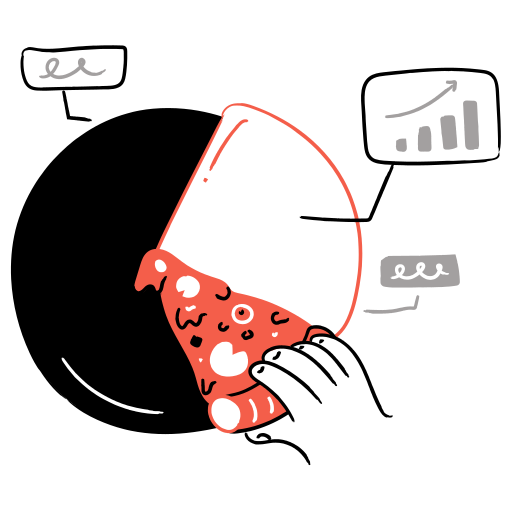

# DashMe

  

DashMe is a cross-platform business intelligence project exploring food safety and regulatory risk through public data. It combines interactive analyses built with Qlik Sense, Tableau, and Microsoft Power BI.

## Data and analyses

- **Qlik Sense:** European RASFF food and feed safety notifications.
- **Tableau:** U.S. FDA enforcement reports and product recalls.
- **Power BI:** EFSA / WHO GEMS food contamination measurements.

## Repository

- `data/` — source datasets.
- `src/` — BI project files and Power BI data queries.
- `docs/` — dashboard exports, reports, and the project thesis.
- `scripts/` — cross-platform thesis build scripts.

To build the thesis, run `./scripts/build-thesis.sh` on macOS/Linux or `.\scripts\build-thesis.ps1` on Windows. A LaTeX engine must be installed; see [`scripts/README.md`](scripts/README.md) for details.

## License

This project is licensed under the MIT License. Copyright (c) 2026 Vinello28, Serelly, and Ranski04. See [`LICENSE`](LICENSE).
